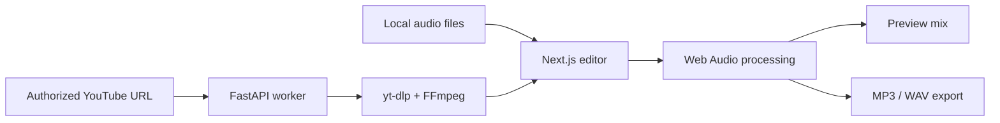

<div align="center">


# ClipMerge 🎧

### Cut. Mix. Merge. Your way.

**A lightweight, browser-first audio editor for arranging, trimming, and mixing clips — with MP3 and WAV exports.**

    

[Features](#-features) · [Quick start](#-quick-start) · [How it works](#-how-it-works) · [Deployment](#-deployment) · [Troubleshooting](#-troubleshooting)

</div>

---

## ✨ What is ClipMerge?

ClipMerge is a **Next.js + TypeScript audio editing app** that lets you combine multiple audio clips right in your browser. Upload your files, choose exact time ranges, adjust levels and fades, arrange the sequence, preview the result, and export a finished mix.

Most editing happens **locally in your browser** through the Web Audio API. An **optional FastAPI worker** enables importing audio from YouTube videos you have permission to download; it is **not required** for ordinary file-based editing.

## 🎛️ Features

| Feature | What you can do |
| --- | --- |
| 📂 Multiple audio sources | Upload and manage multiple local audio files |
| ✂️ Precise trimming | Set start and end timestamps for each clip |
| ↕️ Clip arrangement | Reorder clips before rendering |
| 🎚️ Volume & fades | Set clip volume and fade-in/fade-out |
| 🔀 Smooth transitions | Choose crossfade or silence between clips |
| ▶️ Preview | Listen to your assembled mix before exporting |
| 📥 Export | Download **MP3 at 192 kbps** or **WAV** |
| 🔗 Optional YouTube import | Import eligible, authorized audio using the Python worker |
| 💾 Project settings | Download editing settings as JSON (audio files are not included) |

> **No login or database is required for this prototype.** Local audio editing works even when the optional import service is offline.

## 🧰 Tech stack

| Layer | Technology |
| --- | --- |
| Frontend | Next.js 15, React, TypeScript |
| Audio editing & rendering | Web Audio API, browser-based WAV/MP3 encoding |
| Optional import API | Python 3.11+, FastAPI |
| Authorized video audio extraction | yt-dlp and FFmpeg |
| Frontend deployment | Vercel |
| Optional worker deployment | Railway or Render |

## 🚀 Quick start

### 1. Run the frontend

**Requirements:** Node.js **20.9+** and npm (Node 22 LTS recommended).

```bash
npm install
```

Create the local environment file:

```powershell
# Windows PowerShell
Copy-Item .env.example .env.local
```

```bash
# macOS / Linux
cp .env.example .env.local
```

In `.env.local`:

```env
NEXT_PUBLIC_AUDIO_API_URL=http://localhost:8080
```

Start the app:

```bash
npm run dev
```

Open **http://localhost:3000**. You can now upload audio, trim clips, preview, and export without starting the Python worker.

### 2. Run the optional import backend

**Requirements:** Python **3.11+** and FFmpeg (system installation or compatible bundled executable).

In a **second terminal**:

```bash
cd worker
python -m venv .venv
```

Activate your virtual environment:

```powershell
# Windows PowerShell
.venv\Scripts\Activate.ps1
```

```bash
# macOS / Linux
source .venv/bin/activate
```

Install and run:

```bash
python -m pip install --upgrade pip
python -m pip install -r requirements.txt
python -m uvicorn main:app --host 127.0.0.1 --port 8080
```

Check the service at **http://127.0.0.1:8080/health** (expected `{"ok":true}`) or open **http://127.0.0.1:8080/docs**.

**Windows tip:** If `python` is not found, install Python 3.11+ or use an installed version via `py -3.11`. You can run `.venv\Scripts\python.exe -m uvicorn main:app --host 127.0.0.1 --port 8080` without activating the environment.

## 🎬 How to use

1. Open **http://localhost:3000** and upload two audio files you own.
2. Set each clip's start/end timestamps and adjust the order.
3. Set volume and fade-in/fade-out for each clip.
4. Choose a crossfade or silence gap between clips.
5. Select **Preview mix** and listen.
6. Export as **MP3 (192 kbps)** or **WAV**.
7. Optionally import audio from an authorized YouTube URL if the worker is running.

## 🧩 How it works



**Local uploads** are decoded, trimmed, mixed, and exported in the browser. **Optional YouTube imports** are processed by the worker, which streams an MP3 back to the browser and removes temporary processing files. The project-settings JSON contains editing configuration, **not the source audio**; JSON re-import is not currently implemented.

## 📁 Project structure

```text
clipmerge/
├── app/                     # Next.js routes, layout, styles
├── lib/audio.ts             # Web Audio rendering, MP3/WAV encoding
├── types/                   # TypeScript definitions
├── worker/
│   ├── main.py              # FastAPI /extract and /health
│   ├── requirements.txt
│   ├── nixpacks.toml        # Railway build configuration
│   ├── render-build.sh      # Render build script
│   ├── render.yaml          # Render Blueprint
│   └── start.sh             # Platform PORT startup
├── .env.example             # Environment variable template
├── DEPLOY-NO-DOCKER.md      # Deployment details
└── README.md
```

## ☁️ Deployment

**Frontend — Vercel:** Import the GitHub repository, use Next.js with the repository root, and set `NEXT_PUBLIC_AUDIO_API_URL` to your deployed worker's **HTTPS URL**. Redeploy after changing public environment variables.

**Optional backend — Railway:** Deploy the same repository with root directory `worker`, use the included Nixpacks configuration where supported, set start command `sh start.sh`, and configure `ALLOWED_ORIGINS` for your frontend URL.

**Optional backend — Render:** Create a Python Web Service with root directory `worker`, build command `bash render-build.sh`, start command `sh start.sh`, and health check `/health`. Configure `ALLOWED_ORIGINS`.

> You do **not** need Docker or Nginx. For full step-by-step deployment, see [DEPLOY-NO-DOCKER.md](DEPLOY-NO-DOCKER.md). Hosting availability, limits, and pricing may change.

## 🛠️ Troubleshooting

| Problem | What to check |
| --- | --- |
| `Cannot read properties of undefined (reading 'NEXT_PUBLIC_AUDIO_API_URL')` | In Next.js, access `process.env.NEXT_PUBLIC_AUDIO_API_URL`, **not** `import.meta.env...`; ensure `.env.local` is in the project root and restart `npm run dev` |
| `YouTube backend not configured` | Set `NEXT_PUBLIC_AUDIO_API_URL` and restart/redeploy the frontend |
| CORS error | Ensure the backend `ALLOWED_ORIGINS` includes the exact frontend origin |
| Worker `/health` fails | Verify worker startup logs, dependencies, and port |
| YouTube import fails | Check permissions, source restrictions, yt-dlp updates, and FFmpeg/ffprobe availability |
| MP3 export is slow | Reduce clip duration; encoding uses your device's CPU |
| Build fails | Check Node version and inspect TypeScript/build errors |

## ⚠️ Important limitations

- You must have **rights and authorization** to download any YouTube content. YouTube does not provide a general-purpose official audio download API, and some URLs may fail due to service restrictions or cloud-provider IP blocking.
- Uploaded files are limited to **100 MB each**, and combined exports to **30 minutes** in the current UI.
- The optional importer has a **120-second timeout** and is not hardened for unrestricted public use. Add authentication, rate limiting, quotas, monitoring, and abuse protection before public deployment.
- `NEXT_PUBLIC_` values are visible in browser code. **Never store secrets** in them.
- Crossfades are simple gain envelopes and are not loudness-normalized.
- This is a **prototype**; a complete production deployment has not been independently verified here.

## 🧪 Useful commands

```bash
npm run dev       # Start frontend
npm run lint      # Lint/type checks as configured
npm run build     # Build frontend
npm run start     # Run production frontend
```

---

<div align="center">

**ClipMerge** · Cut. Mix. Merge. Your way. 🎶

*Made for creators who want a simple, browser-first audio editing workflow.*

</div>
